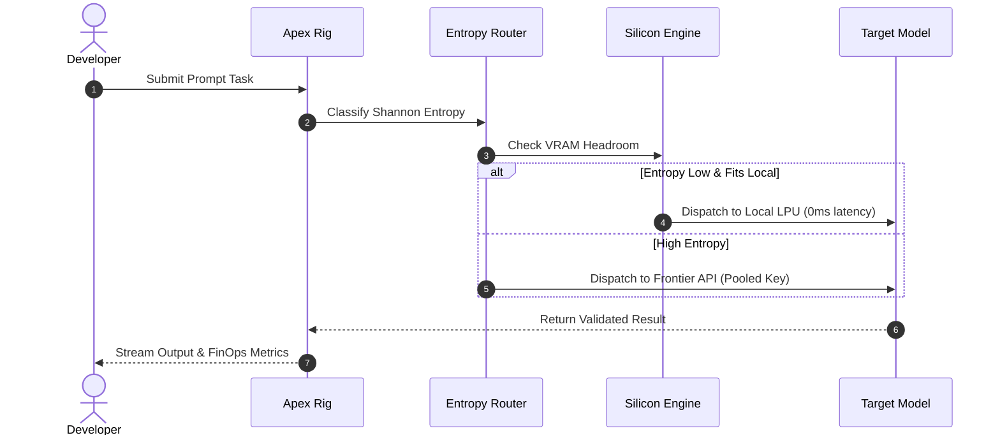
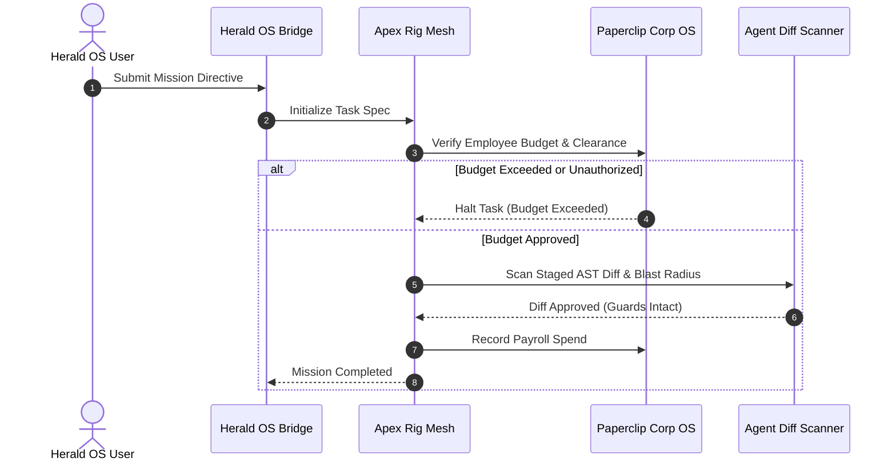
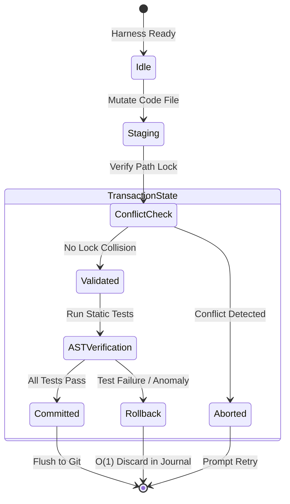

# Diagram Repository: Apex Rig (`apex-rig`)

---

## 1. Macro-System Component Graph

```mermaid
graph TD
    classDef slate fill:#1e293b,stroke:#475569,stroke-width:1px,color:#f8fafc;
    classDef edgeLabel fill:#0f172a,stroke:#334155,color:#94a3b8;

    Client["Client / IDE / CLI"]:::slate
    Orch["ApexRigOrchestrator"]:::slate

    subgraph HarnessSubsystem ["Multi-Harness Subsystem"]
        Sup["ProcessSupervisor"]:::slate
        Trie["PrefixRadixTrie"]:::slate
        Journ["WorkspaceJournal"]:::slate
    end

    subgraph RoutingSubsystem ["Cognitive Router Subsystem"]
        Ent["EntropyRouter"]:::slate
        Pool["KeyPooler"]:::slate
        Arb["LatencyArbiter"]:::slate
    end

    subgraph SiliconSubsystem ["Silicon & Memory Subsystem"]
        Fit["LLMFitEngine"]:::slate
        VRAM["VRAMProjector"]:::slate
        Run["LocalRunner"]:::slate
    end

    subgraph GridAdapters ["Enterprise Grid & Ecosystem Adapters"]
        FW["FirmwareAdapter (apex-firmware)"]:::slate
        CF["ContextFabricAdapter (apex-contextfabric)"]:::slate
        CM["CapitalMatrixAdapter (apex-capitalmatrix)"]:::slate
        SN["StarNetAdapter (Desktop Station)"]:::slate
        HD["HeraldOSAdapter (Hermes Agent)"]:::slate
        PC["PaperclipAdapter (Company OS)"]:::slate
        TP["TelepathyBusAdapter (IPC Ring)"]:::slate
        IK["ImmuneKernelAdapter (Zero-Trust)"]:::slate
        AD["AgentDiffAdapter (AST Validator)"]:::slate
    end

    Client --> Orch
    Orch --> Sup & Ent & Fit
    Sup --> Trie & Journ
    Ent --> Pool & Arb
    Fit --> VRAM & Run
    Orch --> FW & CF & CM & SN & HD & PC & TP & IK & AD
```

---

## 2. Sub-Millisecond Task Arbitration Sequence ($\le 5$ Lifelines)

---

## 3. Paperclip Employee Governance & Herald Mission Flow ($\le 5$ Lifelines)

---

## 4. Speculative Workspace Transaction State Machine

